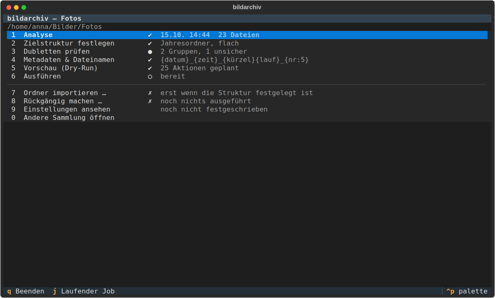
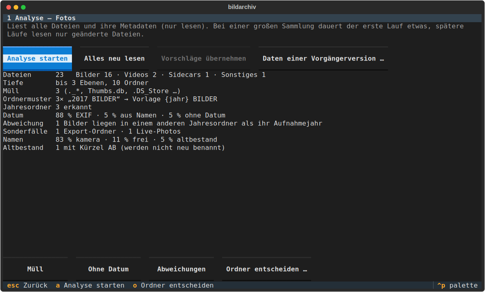
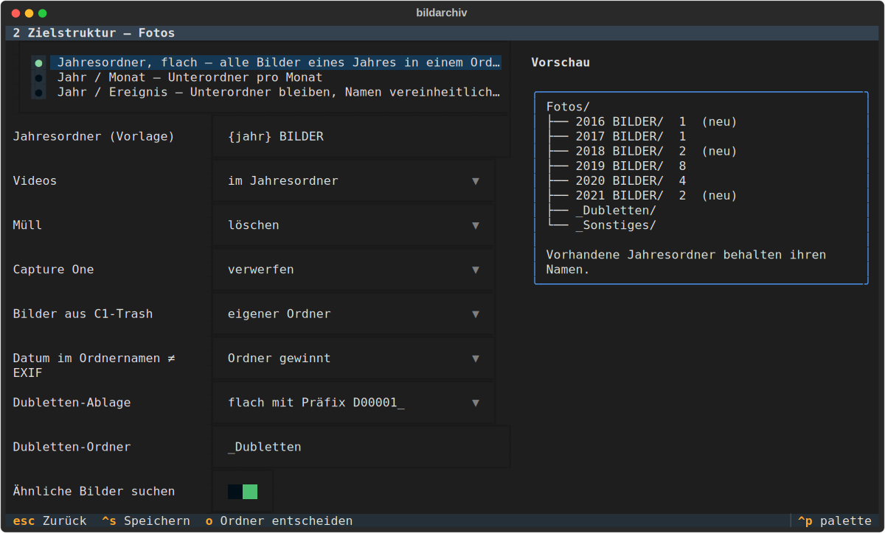
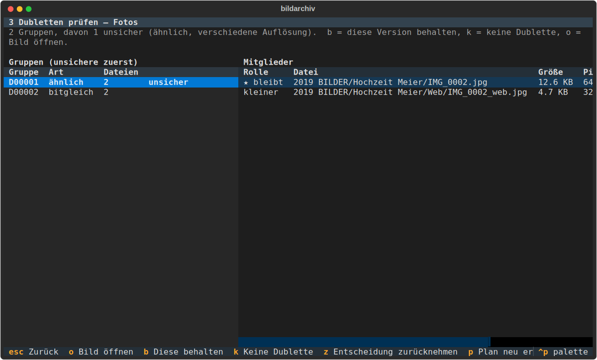
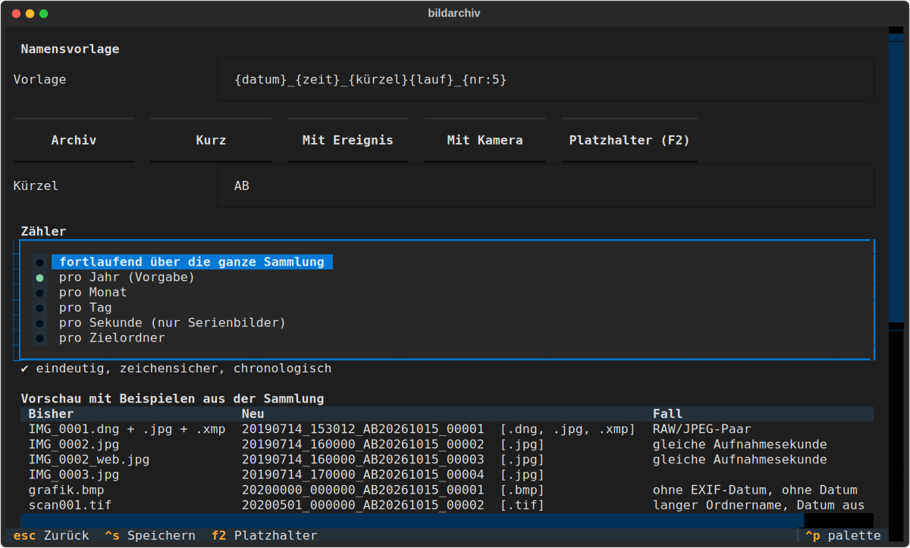
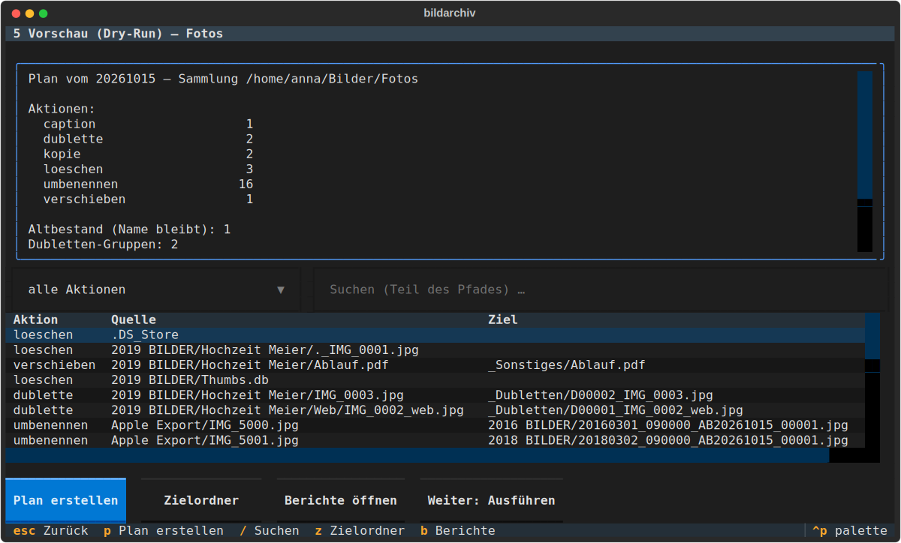
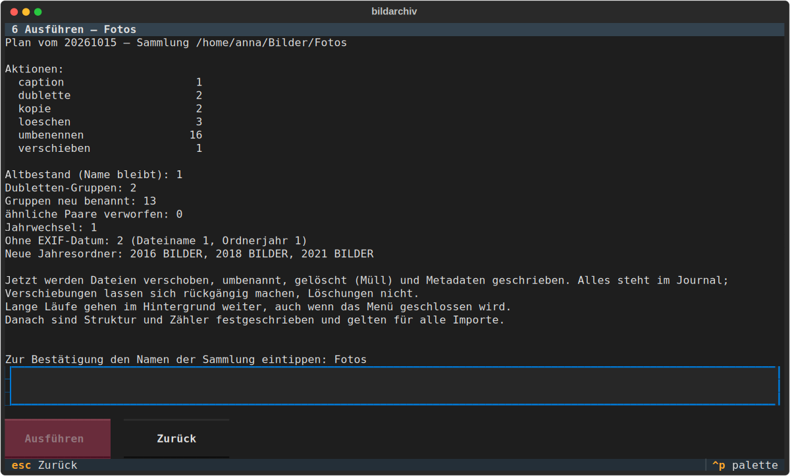
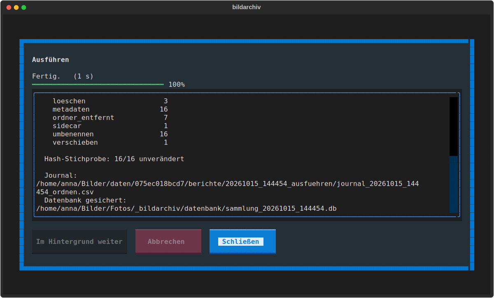
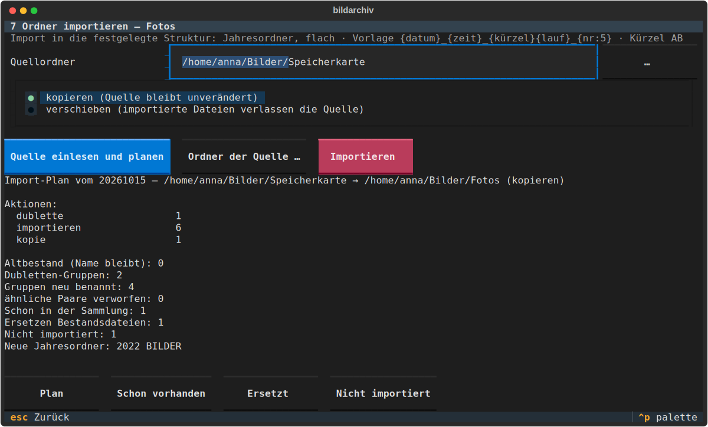

# bildarchiv

**Gewachsene Bildsammlungen aufräumen, ohne etwas zu verlieren.**

`bildarchiv` bringt eine über Jahre gewachsene Fotosammlung in eine einheitliche Ordnung: eine klare
Ordnerstruktur, eindeutige Dateinamen und keine doppelten Bilder mehr. Woher ein Bild ursprünglich
kam, bleibt in seinen Metadaten erhalten. Bedient wird das Werkzeug über ein Menü im Terminal.

*English: a terminal tool that reorganizes grown photo collections into a consistent year-based
structure, detects exact and near duplicates, preserves original file and folder names in the
metadata and renames files uniquely. The user interface is in German.*



## Worum es geht

Wer lange fotografiert, kennt das: Ordner in Ordnern in Ordnern, dieselben Bilder in „Auswahl“, „Web“
und „Kopie von Auswahl“, RAW und JPEG in getrennten Unterordnern, Scans ohne Datum, ein Export aus der
Fotos-App mit Bildern aus zehn Jahren, Kameranamen wie `IMG_4711.JPG` fünfmal vergeben. Dazu
Hilfsdateien wie `Thumbs.db`, `.DS_Store` oder `._IMG_4711.JPG`.

`bildarchiv` macht daraus eine Sammlung wie diese:

```
Vorher                                         Nachher
Fotos/                                         Fotos/
├── 2019 BILDER/                               ├── 2018 BILDER/
│   ├── Hochzeit Meier/                        │   └── 20180801_100000_AB20261015_00001.jpg
│   │   ├── IMG_0001.CR2                       ├── 2019 BILDER/
│   │   ├── IMG_0001.JPG                       │   ├── 20190714_153012_AB20261015_00001.cr2
│   │   ├── IMG_0001.xmp                       │   ├── 20190714_153012_AB20261015_00001.jpg
│   │   ├── IMG_0002.JPG                       │   ├── 20190714_153012_AB20261015_00001.xmp
│   │   └── Web/IMG_0002_web.jpg               │   └── 20190714_160000_AB20261015_00002.jpg
│   ├── Urlaub/IMG_0100.JPG   (von 2018)       ├── 2021 BILDER/
│   └── Thumbs.db                              │   ├── 20210304_090000_AB20261015_00001.jpg
└── Apple Export/                              │   └── 20210304_090000_AB20261015_00001.mov
    ├── IMG_5003.JPG                           ├── _Dubletten/
    └── IMG_5003.MOV   (Live-Photo)            │   ├── D00001_20190714_160000_AB20261015_00002.jpg
                                               │   └── D00001_IMG_0002_web.jpg
                                               └── _Sonstiges/
```

Dabei gilt:

- **Erst ansehen, dann ändern.** Jeder Schritt läuft zuerst als Probelauf (Dry-Run) mit Berichten.
  Erst nach ausdrücklicher Bestätigung wird etwas an den Dateien geändert
- **Nichts geht verloren.** Dubletten werden nicht gelöscht, sondern nach `_Dubletten/` verschoben.
  Der alte Dateiname und der alte Ordnerpfad stehen danach in den Metadaten jedes Bildes
- **Alles lässt sich zurücknehmen.** Jede Ausführung schreibt ein Journal, aus dem sich Verschiebungen
  und Umbenennungen wieder rückgängig machen lassen
- **Die Sammlung bestimmt die Regeln.** Vorhandene Ordnernamen, Kürzel und bereits geordnete Teile
  werden erkannt und übernommen, statt sie zu überschreiben
- **Neue Bilder passen sich ein.** Ist die Struktur einmal festgelegt, lassen sich weitere Ordner
  (Speicherkarte, Handy-Export, Ordner von anderen) in dieselbe Ordnung importieren

## Installation

Voraussetzungen: Linux, Python 3.11 oder neuer und [exiftool](https://exiftool.org/).

```
sudo apt install libimage-exiftool-perl     # Debian/Ubuntu
pipx install git+https://github.com/a-schmidtlab/bildarchiv.git
```

Alternativ aus einem heruntergeladenen Stand:

```
python3 -m venv ~/.venvs/bildarchiv
~/.venvs/bildarchiv/bin/pip install .
```

## Schnellstart

```
bildarchiv /pfad/zur/Sammlung
```

Dann im Menü nacheinander die Punkte **1** bis **5** aufrufen. Bis hierhin wird in der Sammlung nichts
verändert. Erst Punkt **6** führt den Plan aus.

**Tipp:** Vor dem ersten Ausführen eine Sicherung der Sammlung anlegen. Das Werkzeug ist vorsichtig
gebaut, schreibt aber Metadaten in die Bilddateien. Das lässt sich nicht automatisch zurücknehmen.

## Anleitung: eine Sammlung ordnen

### Sammlung öffnen

`bildarchiv` ohne Angabe zeigt die zuletzt geöffneten Sammlungen und eine Ordnerauswahl. Eine Sammlung
ist einfach ein Ordner mit Bildern, egal wie verschachtelt. Im Hauptmenü (Bild oben) zeigt jede Zeile
den Stand des Schritts:

| Zeichen | Bedeutung |
|---|---|
| ✔ | erledigt |
| ● | erledigt, aber mit Hinweis (z. B. unsichere Dubletten, Plan veraltet) |
| ○ | offen |
| ✗ | noch nicht möglich |
| ■ | festgeschrieben |

Die Ziffern **1–9** und **0** öffnen den jeweiligen Punkt, **Esc** führt zurück, **q** beendet.

### 1 Analyse



**Analyse starten** liest alle Dateien und ihre Metadaten. Das ist ein reiner Lesevorgang. Bei großen
Sammlungen dauert der erste Lauf eine Weile (Größenordnung: 20 Minuten für 250.000 Dateien von einer
USB-Platte). Spätere Läufe lesen nur Dateien, die sich geändert haben.

Der Befund zeigt, was gefunden wurde:

- **Ordnermuster**: Wie heißen die vorhandenen Jahresordner? Aus „2017 BILDER“ wird die Vorlage
  `{jahr} BILDER`, neue Jahresordner bekommen denselben Aufbau
- **Datum**: Wie viele Bilder ein Aufnahmedatum in den EXIF-Daten haben, wie viele nur eins im Namen
- **Abweichung**: Bilder, die in einem anderen Jahresordner liegen als in dem ihres Aufnahmejahres
- **Sonderfälle**: Capture-One-Sessions, Export-Ordner mit Bildern aus vielen Jahren, Live-Photos
- **Namen**: Kameranamen, Handynamen, freie Namen und **Altbestand**, also Bilder, die schon nach dem
  gewählten Schema benannt sind und deshalb nicht noch einmal umbenannt werden

Beim ersten Mal übernimmt die Analyse ihre Vorschläge direkt in die Einstellungen. Unten öffnen die
Knöpfe Listen der betroffenen Dateien. Mit **Ordner entscheiden …** legt man für jeden Ordner fest,
was mit ihm geschehen soll (siehe nächster Schritt).

### 2 Zielstruktur festlegen



Drei Strukturen stehen zur Wahl:

| Struktur | Ergebnis |
|---|---|
| **Jahresordner, flach** | alle Bilder eines Jahres in einem Ordner: `2019 BILDER/…` |
| **Jahr / Monat** | `2019 BILDER/2019-07/…` |
| **Jahr / Ereignis** | `2019 BILDER/2019-07-14 Hochzeit Meier/…`. Die Unterordner bleiben, ihre Namen werden vereinheitlicht (Datum + Name) |

Weitere Einstellungen auf dieser Seite:

- **Jahresordner-Vorlage**: Aufbau der Ordnernamen. Vorhandene Jahresordner behalten ihren Namen
- **Videos**: im Jahresordner (mit neuem Namen) oder in einem eigenen Ordner `Videos/`
- **Müll** (`._*`, `Thumbs.db` …): löschen, nach `_Muell/` verschieben oder liegen lassen
- **Capture One**: Session-Dateien verwerfen, Bilder aus dem Capture-One-Papierkorb getrennt ablegen
- **Datum im Ordnernamen ≠ EXIF**: Wenn ein Ordner „Konzert 12.4.01“ heißt, die Kamera aber 2003
  meldet: Gewinnt der Ordner oder die Kamera?
- **Dubletten-Ablage**: flach mit Präfix `D00001_`, ein Ordner pro Gruppe oder pro Jahr

Rechts zeigt eine Vorschau, welche Jahresordner entstehen und wie viele Bilder hineinkommen.

**Ordner einzeln entscheiden** öffnet eine Liste aller Ordner mit vier Möglichkeiten:

| Entscheidung | Wirkung |
|---|---|
| als Ereignis | Standard. Bei „Jahr / Ereignis“ wird der Ordner zum Ereignisordner |
| auflösen | Bilder werden nach Aufnahmedatum verteilt (gut für Exporte aus der Fotos-App) |
| unverändert lassen | Ordner bleibt, wie er ist (gut für Portfolios oder Projektordner) |
| an die Wurzel | Ordner wird unverändert auf die oberste Ebene verschoben |

### 3 Dubletten prüfen



Dubletten werden beim Erstellen des Plans gesucht (Taste **p**). Links stehen die Gruppen, unsichere
zuerst (ähnliche Bilder mit unterschiedlicher Auflösung). Rechts stehen die Dateien der markierten
Gruppe. Der Stern ★ zeigt, welche Version bleibt.

| Taste | Wirkung |
|---|---|
| **o** | Bild im Standardprogramm öffnen |
| **b** | diese Version behalten statt der vorgeschlagenen |
| **k** | keine Dublette: diese Datei aus dem Vergleich nehmen |
| **z** | Entscheidung zurücknehmen |
| **p** | Plan neu erstellen, damit die Entscheidungen wirken |

Wie die Erkennung genau arbeitet, steht unten unter [Technik](#dublettenerkennung).

### 4 Metadaten & Dateinamen



Neue Dateinamen entstehen aus einer **Namensvorlage**. Die Tabelle unten im Bild zeigt die Vorlage
an Beispielen aus der eigenen Sammlung, ausgesucht nach schwierigen Fällen: ein RAW/JPEG-Paar, ein Bild
ohne Datum, zwei Bilder derselben Sekunde, ein langer Ordnername.

Die Knöpfe setzen fertige Vorlagen ein:

| Vorlage | Ergebnis |
|---|---|
| Archiv: `{datum}_{zeit}_{kürzel}{lauf}_{nr:5}` | `20190714_153012_AB20261015_00123` |
| Kurz: `{datum:JJJJ-MM-TT}_{zeit}_{nr:4}` | `2019-07-14_153012_0123` |
| Mit Ereignis: `{datum}_{ereignis\|slug\|klein\|max:30}_{nr:4}` | `20190714_hochzeit-meier_0123` |
| Mit Kamera: `{datum}_{zeit}[_{kamera\|slug\|klein}]_{nr:4}` | `20190714_153012_canon-eos-5d_0123` |

**F2** zeigt alle Platzhalter (Datum, Zeit, Zähler, Kürzel, Ereignis, Kamera, alter Name …) und Filter
(`slug` für Umlaute und Leerzeichen, `klein`, `max:N`, `oder:Ersatz`). Teile in eckigen Klammern
entfallen, wenn ihr Wert fehlt. Unter der Vorlage prüft das Werkzeug laufend, ob die Namen eindeutig
bleiben, ob sie nur erlaubte Zeichen enthalten und ob sie sich chronologisch sortieren.

Der **Zähler** beginnt wahlweise pro Jahr (Vorgabe), pro Monat, pro Tag, pro Sekunde, pro Zielordner
oder läuft über die ganze Sammlung.

Darunter wird festgelegt, wohin die Herkunft geschrieben wird:

| Inhalt | Standardfeld |
|---|---|
| alter Dateiname | `XMP-xmpMM:PreservedFileName` |
| alter Ordnerpfad | `XMP-iptcExt:Event` |
| neuer Name | `EXIF:ImageUniqueID` |

### 5 Vorschau (Dry-Run)



**Plan erstellen** berechnet alle Aktionen, ohne etwas zu ändern: umbenennen, verschieben, Dubletten
ablegen, Bildunterschriften übernehmen, Müll entfernen. Die Liste lässt sich nach Aktion filtern und
durchsuchen. **Zielordner** zeigt, wie viele Dateien in welchem Ordner landen. **Berichte öffnen**
öffnet den Ordner mit den CSV-Berichten (Plan, Dubletten, Jahreswechsel, Bilder ohne Datum …). Sie
lassen sich direkt in LibreOffice oder Excel öffnen.

Ändert sich danach eine Einstellung oder eine Dubletten-Entscheidung, gilt der Plan als veraltet und
muss neu erstellt werden.

### 6 Ausführen



Zur Bestätigung wird der Name der Sammlung eingetippt. Dann läuft die Ausführung als eigener Prozess.
Das Fenster zeigt den Fortschritt und lässt sich schließen, die Arbeit geht im Hintergrund weiter.



Am Ende stehen eine Zusammenfassung, eine Stichprobe, ob die Bilddaten durch das Schreiben der
Metadaten unverändert geblieben sind, und der Pfad zum Journal. Ab jetzt sind Struktur, Namensvorlage
und Zähler **festgeschrieben**. In der Sammlung liegt ein Ordner `_bildarchiv/` mit den Einstellungen,
den Berichten und einer Sicherung der Arbeitsdatenbank.

### 7 Weitere Ordner importieren



Ein neuer Ordner wird mit derselben Analyse gelesen und in die festgelegte Struktur einsortiert:

- **kopieren** (die Quelle bleibt unverändert) oder **verschieben**
- Bilder, die **schon in der Sammlung** sind, werden übersprungen. Ein neues RAW zu einem vorhandenen
  JPEG bekommt dessen Namen
- Ist die neue Fassung **besser** (mit Bildunterschrift oder höherer Auflösung), ersetzt sie die alte
  unter deren Namen, die alte wandert nach `_Dubletten/`
- **Neue** Bilder bekommen das Namensschema, der Zähler läuft weiter, fehlende Jahresordner werden angelegt
- **Ordner der Quelle …**: Unterordner einzeln als Ereignis übernehmen, auflösen oder auslassen

Die Listen unten zeigen, was schon vorhanden war, was ersetzt wird und was nicht importiert wird.

Eine Sammlung, die schon geordnet ist (etwa mit einer früheren Version), lässt sich auch ohne Ausführen
festschreiben: Knopf **Struktur festschreiben** auf dieser Seite.

### 8 Rückgängig machen

Die Liste zeigt alle Journale, das neueste zuerst. **Enter** nimmt einen Lauf zurück: Verschiebungen
und Umbenennungen werden umgekehrt, Kopien und Importe entfernt, Zähler zurückgesetzt. Mehrere Läufe
nimmt man in umgekehrter Reihenfolge zurück. Gelöschter Müll und geschriebene Metadaten lassen sich
nicht zurücknehmen.

### 9 Einstellungen ansehen

Zeigt alle Einstellungen der Sammlung, auch als TOML, und die Orte von Datenbank und Berichten.

## Kommandozeile

Alle Schritte gibt es auch ohne Menü, etwa für Skripte:

```
bildarchiv analyse ORDNER [--voll]                Sammlung einlesen, Befund zeigen
bildarchiv plan ORDNER                            Dry-Run: Plan und Berichte
bildarchiv ausfuehren ORDNER --ja                 Plan ausführen
bildarchiv import ORDNER QUELLE [--verschieben] [--ausfuehren]
bildarchiv rueckgaengig ORDNER [JOURNAL]          ohne JOURNAL: Liste der Journale
bildarchiv einstellungen ORDNER [--setze gruppe.schluessel=wert …] [--festschreiben]
bildarchiv vorlage "{datum}_{zeit}_{nr:4}" [--zaehler tag]   Vorlage prüfen und ausprobieren
```

## Wo Daten liegen

| Was | Wo |
|---|---|
| Arbeitsdatenbank, Berichte, Journale | `~/.local/share/bildarchiv/<id>/` |
| zuletzt geöffnete Sammlungen | `~/.config/bildarchiv/sammlungen.toml` |
| Einstellungen und Sicherungen (ab dem ersten Ausführen) | `<Sammlung>/_bildarchiv/` |

Vor dem ersten Ausführen schreibt das Werkzeug nichts in die Sammlung. Wird die Sammlung an einem
anderen Rechner geöffnet, stellt es die Arbeitsdatenbank aus der Sicherung in `_bildarchiv/` her.

---

## Technik

### Überblick

`bildarchiv` ist in Python geschrieben. Die Metadaten liest und schreibt
[exiftool](https://exiftool.org/), Bilder dekodiert [Pillow](https://python-pillow.org/), die
Pixelvergleiche rechnet [NumPy](https://numpy.org/), das Menü baut [Textual](https://textual.textualize.io/).
Der Zustand liegt in einer SQLite-Datenbank pro Sammlung.

Ordnen und Importieren laufen durch dieselbe Pipeline:

```
Bestandsaufnahme ─► Einordnen ─► Gruppen ─► Altbestand ─► Datum ─► Dubletten ─► Partner ─► Ziele + Namen ─► Plan
   (exiftool)       Müll, Video,  RAW+JPEG    schon         EXIF,    bitgleich,   RAW folgt    Jahresordner,   Dry-Run,
                    Sonstiges     +Sidecars   benannt?      Name,    ähnlich      dem Original  Zähler          Berichte
                                                            Ordner
                                                                                                    │
                                                    Ausführen ◄─ Bestätigung ◄──────────────────────┘
                                                    Journal, Metadaten, Kontrolle
```

Beim Import kommen die Bilder der Quelle hinzu. Die Dateien der Sammlung nehmen nur am
Dublettenvergleich teil.

### Bestandsaufnahme

- Ein Durchlauf über alle Dateien, dann exiftool in Stapeln zu 200 Dateien, mehrere Prozesse parallel.
  Gelesen werden u. a. `DateTimeOriginal`, `SubSecTimeOriginal`, `CreateDate`, bei Videos
  `Keys:CreationDate` (Ortszeit statt UTC), Kamera, Seriennummer, Bildgröße, Bildunterschriften,
  `ImageUniqueID`, `PreservedFileName` und `UserComment`
- **Inkrementell**: Dateien mit gleicher Größe und Änderungszeit werden nicht neu gelesen. Hashes und
  Miniaturen bleiben in der Datenbank erhalten
- **Klassifikation** nach Endung und Ort: Bild, Video, Sidecar (xmp, acr, xip, aae), Audio-Notiz,
  Capture One, Müll, Sonstiges. Dateien in versteckten Ordnern gelten als Müll

### Gruppen zusammengehöriger Dateien

Dateien mit gleichem Basisnamen im selben Ordner bilden eine Gruppe: `IMG_1.CR2`, `IMG_1.JPG`,
`IMG_1.xmp`, `IMG_1.CR2.xmp`, `IMG_1.MOV` (Live-Photo). Liegen RAW und JPEG in verschiedenen
Unterordnern desselben Ereignisses, werden die Gruppen über Basisname und gleiche Aufnahmezeit
zusammengeführt, sofern sich ihre Formate nicht überschneiden. Eine Gruppe bekommt einen gemeinsamen
neuen Basisnamen, nur die Endungen unterscheiden sich.

### Datum und Jahresordner

Das Aufnahmedatum kommt in dieser Reihenfolge aus `DateTimeOriginal`, `CreateDate`, einem Datum im
Datei- oder Ordnernamen, dem Jahr des Ordners und zuletzt dem Änderungsdatum der Datei. Dabei werden
RAW-Dateien vor JPEG und Bilder vor Videos befragt. Kamera-Standarddaten (1.1.1970, 1.1.1980, 1.1.2000)
gelten als „kein Datum“. Steht im Ordnernamen ein eindeutiges Datum, das dem EXIF-Jahr widerspricht,
gewinnt je nach Einstellung der Ordner oder die Kamera.

### Dublettenerkennung

Ziel ist, **alle Fassungen desselben Bildes** zu finden, auch verkleinerte Web-Fassungen und Kopien
mit geänderten Metadaten, ohne Serienbilder oder unterschiedlich bearbeitete Fassungen
zusammenzuwerfen. Dazu arbeitet die Erkennung in mehreren Stufen, jede schneller und gröber als die
nächste.

**Grundsätze**

- Verglichen wird **nur innerhalb derselben Endung**. RAW, JPEG, TIFF und PSD desselben Motivs sind
  keine Dubletten, sondern Partner und bekommen denselben Namen
- **Metadaten zählen nicht.** Zwei Dateien mit denselben Bilddaten, aber unterschiedlichen
  Stichwörtern, Bewertungen oder Bildunterschriften sind Dubletten
- Es wird **nichts gelöscht**. Jede Gruppe wird nachvollziehbar in `_Dubletten/` abgelegt

**Stufe 1: bitgleiche Bilddaten**

Für jedes Bild und jedes Video berechnet exiftool den `ImageDataHash`, einen MD5-Hash nur über die
eigentlichen Bild- bzw. Mediendaten, ohne EXIF, XMP oder IPTC. Damit sind auch Kopien, in die später
Metadaten geschrieben wurden, sicher als gleich erkennbar. Wo exiftool keinen ImageDataHash liefert
(z. B. PSD, GIF, BMP), dient ein MD5 über die dekodierten RGB-Pixel als Ersatz. Alle Dateien mit
gleicher Endung und gleichem Hash bilden eine Gruppe. Dieser Schritt ist exakt und ohne Fehlalarme.

**Stufe 2: Kandidaten für ähnliche Bilder (dHash)**

Für JPEG, TIFF, PNG, HEIC und WebP wird ein **Differenz-Hash** berechnet:

1. Bild mit korrekter Ausrichtung (EXIF-Orientation) als Graustufen laden. JPEGs werden dabei direkt
   verkleinert dekodiert, das spart Zeit
2. auf 9 × 8 Pixel verkleinern
3. in jeder Zeile jedes Pixel mit seinem rechten Nachbarn vergleichen: heller → 1, sonst 0
4. die 64 Bits ergeben den dHash

Der dHash beschreibt die grobe Helligkeitsverteilung. Er bleibt bei Verkleinerung, neuer
JPEG-Kompression und leichten Tonwertänderungen fast gleich. Fast einfarbige Bilder (weniger als 6 oder
mehr als 58 gesetzte Bits) werden übersprungen, weil ihr dHash nichts aussagt.

Als ähnlich gelten zwei Bilder, deren dHash sich in **höchstens 4 von 64 Bits** unterscheidet. Damit
nicht jedes Bild mit jedem verglichen werden muss (bei 200.000 Bildern wären das 20 Milliarden Paare),
wird der Hash in **5 Abschnitte** zu 13, 13, 13, 13 und 12 Bit zerlegt und jedes Bild unter jedem
Abschnitt einsortiert. Unterscheiden sich zwei Hashes in höchstens 4 Bits, ist mindestens einer der
5 Abschnitte identisch (Schubfachprinzip). Nur Bilder, die sich einen Abschnitt teilen, werden
verglichen. So bleiben aus Milliarden möglicher Paare einige Tausend Kandidaten.

**Stufe 3: Plausibilität**

Ein Kandidatenpaar muss außerdem

- dieselbe Endung haben,
- dasselbe Seitenverhältnis (Abweichung höchstens 2 %),
- und, wenn beide ein Aufnahmedatum haben, **in derselben Sekunde** aufgenommen sein, bei vorhandenen
  Sekundenbruchteilen (`SubSecTimeOriginal`) auch mit gleichem Bruchteil.

**Stufe 4: Pixelprüfung**

Der dHash ist grob. Zwei Serienbilder derselben Sekunde haben oft fast denselben Hash. Deshalb wird
jedes Kandidatenpaar auf **64 × 64 Graustufen-Pixeln** genau verglichen, aufgeteilt in 64 Blöcke zu
8 × 8 Pixeln. Gemessen werden die mittlere Abweichung über das ganze Bild und die Abweichung im
schlechtesten Block. Der Block-Wert fängt Bilder ab, die sich nur in einem kleinen Bereich
unterscheiden, etwa wenn sich eine Person bewegt hat.

| Fall | Vergleich | Grenzwerte |
|---|---|---|
| gleiche Auflösung | Rohwerte (0–255) | mittlere Abweichung ≤ 1,5 und schlechtester Block ≤ 4,0 |
| verschiedene Auflösung | tonwertnormiert (Mittelwert 0, Streuung 1) | mittlere Abweichung ≤ 0,10 und schlechtester Block ≤ 0,40 |
| Miniatur (kleineres Bild unter 256 Pixel lange Seite) | 16 × 16, tonwertnormiert | mittlere Abweichung ≤ 0,05 |

Die Tonwertnormierung sorgt dafür, dass eine verkleinerte Web-Fassung mit anderem Kontrast oder
anderer Schärfung noch als dasselbe Bild erkannt wird. Paare, die hier scheitern, erscheinen im
Bericht `aehnlich_abgelehnt.csv`, damit man nachsehen kann, was knapp nicht zusammengefasst wurde.

**Stufe 5: kleinere Fassungen eindeutig zuordnen**

Bestehen zwei Bilder gleicher Auflösung die Pixelprüfung, kommen sie in eine Gruppe. Bei
verschiedener Auflösung ist Vorsicht nötig: Eine 300-Pixel-Vorschau kann zu zwei verschiedenen
Serienbildern passen, die sich nur in Details unterscheiden. Würde man sie beiden zuordnen, würden
die beiden Serienbilder über die Vorschau verbunden. Deshalb wird eine kleinere Fassung **nur dann**
einer Gruppe zugeordnet, wenn alle zu ihr passenden größeren Bilder bereits dasselbe Bild sind. Die
Zuordnung beginnt mit den größten Bildern, damit sich Ketten (Original → 1200 px → 300 px) sauber
auflösen. Passt eine Miniatur zu mehreren verschiedenen Bildern, bleibt sie, wo sie ist.

**Stufe 6: Gruppenbildung**

Alle gefundenen Verbindungen (bitgleich, ähnlich, kleinere Fassung) werden mit einer
Union-Find-Struktur zu Gruppen zusammengefasst. Eine Gruppe gilt als **unsicher**, wenn sie über eine
Verbindung mit unterschiedlicher Auflösung entstanden ist. Diese Gruppen stehen im Menü oben.

**Welche Version bleibt?**

1. eine im Menü mit **b** gewählte Version
2. sonst die mit den **meisten Pixeln**, bei Gleichstand nacheinander:
   - mit Bildunterschrift
   - (beim Import) die Datei, die schon in der Sammlung ist
   - aus einem Jahres- oder datierten Ordner statt aus einem Export
   - nicht aus einem Ordner „Original(e)“
   - Teil einer Gruppe mit mehr Formaten (z. B. JPEG mit RAW-Partner)
   - größere Datei, dann kürzerer Pfad

**Was mit den anderen Versionen geschieht**

- Sie werden nach `_Dubletten/` verschoben, zusammen mit eigenen Sidecars wie `IMG_1.jpg.xmp`. Der alte
  Name und Ordnerpfad werden auch in sie geschrieben
- Die bleibende Version wird **zusätzlich als Kopie** in denselben Dubletten-Ordner gelegt, damit jede
  Gruppe vollständig beisammen liegt und sich beurteilen lässt
- Hat die bleibende Version keine Bildunterschrift, eine andere aber schon, wird diese übernommen
- Partner einer verschobenen Dublette, die selbst keine Dublette sind (etwa das RAW zu einem doppelten
  JPEG), schließen sich der bleibenden Version an und bekommen deren Namen

**Beim Import** nehmen die Bilder der Sammlung am Vergleich teil, ohne dass die Sammlung neu gelesen
wird: Ihre Hashes und Miniaturen stehen in der Datenbank. Gewinnt eine Datei der Sammlung, wird die
neue nicht importiert. Gewinnt die neue (bessere Auflösung oder Bildunterschrift), ersetzt sie die alte
unter deren Namen, und die alte kommt nach `_Dubletten/`.

**Eingreifen**: Mit **k** („keine Dublette“) nimmt man eine Datei ganz aus dem Vergleich, mit **b**
bestimmt man die bleibende Version. Die Entscheidungen bleiben gespeichert und gelten auch für spätere
Pläne.

**Aufwand**: Der ImageDataHash muss jede Datei einmal ganz lesen. Für die Miniaturen wird nur
verkleinert dekodiert. Beides läuft parallel und wird gespeichert, spätere Pläne rechnen nur noch für
neue oder geänderte Dateien. Der Vergleich selbst dauert für 200.000 Bilder etwa eine Minute.

**Grenzen**: RAW-Dateien werden nur bitgleich verglichen. Für HEIC ist die Ähnlichkeitssuche nur mit
dem Zusatzpaket `pillow-heif` möglich. Stark beschnittene oder gespiegelte Fassungen werden nicht als
ähnlich erkannt, weil sich ihr Seitenverhältnis bzw. ihre Helligkeitsverteilung ändert.

### Namen und Altbestand

Die Namensvorlage wird von einem eigenen kleinen Parser gelesen, es wird kein Code ausgeführt. Aus
derselben Vorlage entsteht ein regulärer Ausdruck, mit dem sich vorhandene Namen zurücklesen lassen
(Datum, Kürzel, Nummer). So werden bereits benannte Dateien erkannt, auch nach einer früheren Vorlage,
und ihre Nummern fließen in den Zähler ein. Jeder neue Name wird vor der Vergabe gegen alle Namen der
Sammlung geprüft, ohne Rücksicht auf Groß- und Kleinschreibung. Einzelheiten:
[docs/konzept.md](docs/konzept.md).

### Metadaten schreiben

exiftool schreibt die Felder stapelweise aus einer CSV-Datei, mit unverändertem Änderungsdatum der
Datei (`-P`). Danach wird jedes Feld zurückgelesen und mit dem Sollwert verglichen. Dateien, in die sich
nichts schreiben lässt (AVI, BMP, beschädigte Dateien), bekommen ein XMP-Sidecar mit denselben
Angaben. Bei Videos und GIFs werden die XMP-Varianten der Felder verwendet.

### Sicherheit beim Ausführen

- Ein Plan wird nur ausgeführt, wenn er noch aktuell ist: Einstellungen, Entscheidungen und Bestand
  seit dem Plan unverändert, alle Quellen vorhanden und kein Ziel schon belegt
- Reihenfolge: erst Dateien bewegen, dann Metadaten schreiben, dann die Kopien der bleibenden
  Versionen anlegen, sodass auch die Kopien die neuen Metadaten tragen
- Jede einzelne Aktion steht mit Ergebnis im Journal (CSV). Rückgängig liest es rückwärts
- Kopieren übernimmt Daten und Zeitstempel, aber keine Dateirechte, weil exFAT sie nicht kennt
- Nach dem Schreiben wird an einer Stichprobe geprüft, dass sich der ImageDataHash nicht verändert hat
- Ausführen und Rückgängig lassen sich nicht mittendrin abbrechen, damit Journal und Bestand zusammenpassen

### Hintergrundprozesse

Lange Schritte startet das Menü als eigenen Prozess (`bildarchiv job …`). Dieser schreibt Phase,
Fortschritt und Meldungen in die Arbeitsdatenbank, das Menü liest sie laufend mit. Deshalb
kann man das Menü schließen und später wieder öffnen, die Anzeige setzt dort fort. Eine Sperre
verhindert zwei gleichzeitige Läufe auf derselben Sammlung.

### Programmaufbau

```
bildarchiv/
├── __main__.py          Kommandozeile (ohne Argument: Menü)
├── ablauf.py            die Arbeitsschritte für Menü und Kommandozeile
├── jobs.py              Hintergrundprozesse
├── sammlung.py          Sammlung: Einstellungen, Datenbank, Speicherorte
├── einstellungen.py     Vorgaben, TOML, Prüfung
├── kern/                inventar, klassifikation, datierung, analyse, struktur, hashes,
│                        dubletten, vorlage, planung, metadaten, ausfuehren, altdaten, db, exif
└── menue/               Textual-Oberfläche
```

## Entwicklung

```
pip install -e ".[test]"
pytest
```

Für die Tests werden zusätzlich `exiftool` und `ffmpeg` gebraucht. Die Tests erzeugen eine absichtlich
unordentliche Sammlung (RAW/JPEG-Paare mit Sidecars, Web-Fassungen mit Bildunterschrift, bitgleiche
Kopien, falsche Jahresordner, Scans ohne EXIF, Serienbilder derselben Sekunde, Export-Ordner,
Live-Photos, Müll, nicht beschreibbare Dateien, bereits benannte Dateien). Daran prüfen sie Ordnen,
einen zweiten Lauf ohne Änderungen, Import und Rückgängig.
